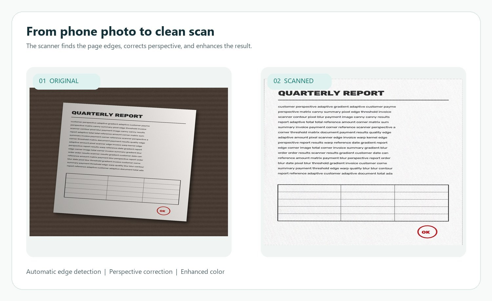

# Smart Document Scanner

Turn a phone photo into a clean, flat document scan. This is my first end-to-end Python project, built with Streamlit and classic computer vision using OpenCV — no AI model required.

**[Try the live app](https://smart-document-scanner-32sbgxsabk6afqzbtgqtwk.streamlit.app/)** · **[View the source code](https://github.com/mostafa0155130120-dotcom/Smart-Document-Scanner)**

## See the result

The example below uses the project's bundled sample image. The app detects the page, corrects its perspective, then applies the selected scan look.



## What it can do

- Scan from an uploaded JPG/PNG, a device camera, or the bundled sample.
- Find the document edges and flatten perspective, with a whole-photo fallback.
- Preview detected corners and a debug view to help troubleshoot difficult photos.
- Choose Original Color, Enhanced Color, Grayscale, Black & White, or Adaptive Threshold.
- Adjust brightness, contrast, sharpness, and rotation.
- Download a scan as PNG/JPG or combine pages into one PDF.
- Switch the interface between English and Arabic.

## Run it locally

Requires Python 3.11 or newer.

```powershell
py -3.11 -m venv .venv
.venv\Scripts\Activate.ps1
pip install -r requirements.txt
streamlit run app.py
```

Open the local address shown in the terminal (usually `http://localhost:8501`). The camera input works on localhost or on an HTTPS deployment.

## Deploy with Streamlit Community Cloud

1. Select this GitHub repository and the `main` branch.
2. Set the app file to `app.py`.
3. Deploy. Runtime packages are listed in `requirements.txt`.

## How it works

1. **Detect:** resize a working copy, find edges and contours, then select a plausible four-corner page.
2. **Flatten:** use the four corners to apply a perspective transform to the original-resolution image.
3. **Enhance and export:** apply the selected scan adjustments, then prepare an image download or a multi-page PDF.

## Project structure

| File | Purpose |
| --- | --- |
| `app.py` | Streamlit interface, language toggle, controls, and exports |
| `scanner.py` | Document detection and perspective correction |
| `image_processing.py` | Scan modes and image adjustments |
| `pdf_generator.py` | Multi-page PDF generation |
| `utils.py` | Image validation, loading, and export helpers |
| `samples/` | Example document and sample-image generator |
| `tests/` | Automated checks for the main processing features |

## Learning note

This first project helped me connect image-processing steps to a complete user workflow: handling uploads, detecting page corners, correcting perspective, offering useful scan modes, and exporting a finished document. I also learned how to structure a Python app and prepare it for deployment.

---

Built as a learning project. Contributions and feedback are welcome.
